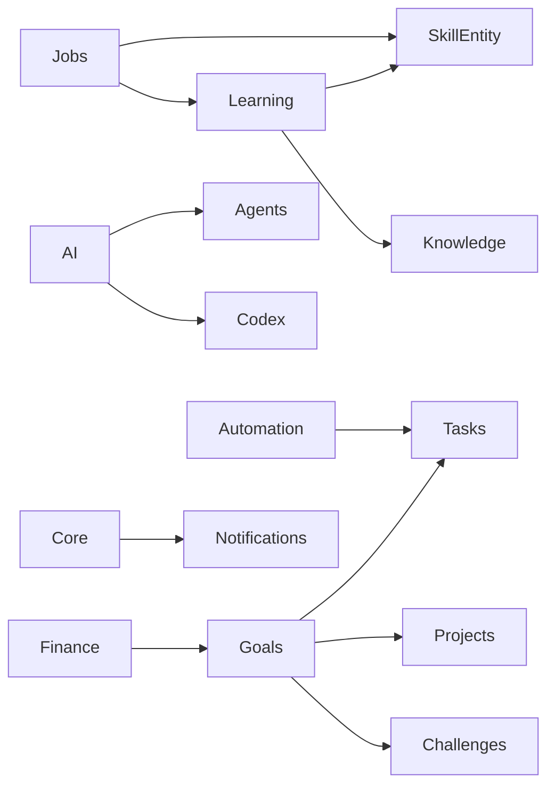

# SO_IAM_OS — Living Project Master Map

**Purpose:** one starting point to understand what exists, where it lives, how domains connect, what is verified, what remains unknown, and where work should resume.

> **Source of truth:** current source/configuration in the repository. `Build/` is the authoritative engineering and architecture documentation root. `project_docs/` is intended to remain the user-facing documentation website, but it is absent from the supplied archive. EGM is the permanent governance workflow.

## 1. Current project position

- Product vision from repository README: an adaptive personal AI operating system integrating work, learning, goals, career opportunities, finances, projects, automation, and knowledge. Vision is not an implementation status.
- Backend: Django / Django REST Framework project under `backend_django/`.
- Frontend: Vue 3 application under `frontend_vue/`, routed through `frontend_vue/src/router/index.js`.
- Backend app directories discovered by `apps.py`: **26**; app entries in `INSTALLED_APPS`: **25** (`skills/` is a scaffold-only, unregistered package).
- Frontend route declarations extracted: **44**.
- Django model class declarations found by static scan: **164**.
- Backend URL declarations: **112** literal `path`/`re_path` lines in app URL files; not a resolved endpoint count.
- Verification level: static source inspection only; no runtime, test, build, migration, database, browser, or API verification is claimed.

## 2. Start here — authoritative navigation

| Need | Read this first |
|---|---|
| Current exact archive counts and omissions | `Build/source_architecture/00_project_overview/CURRENT_SOURCE_BASELINE_2026-11-23.md` |
| What the user-visible application exposes | `Build/source_architecture/05_catalogues/FRONTEND_SOURCE_CATALOGUE.md` and `03_frontend/FRONTEND_COVERAGE_AUDIT_2026-11-23.md` |
| What backend apps and URL prefixes exist | `Build/source_architecture/05_catalogues/BACKEND_SOURCE_CATALOGUE.md` and `02_backend/BACKEND_COVERAGE_AUDIT_2026-11-23.md` |
| What data models/relations were detected | `Build/source_architecture/05_catalogues/DATABASE_MODEL_CATALOGUE.md` |
| How app domains connect | `Build/source_architecture/04_integration/PROJECT_DEPENDENCY_MAP.md` and `CROSS_APPLICATION_IMPORT_GRAPH.md` |
| Internal app folder structure | `Build/source_architecture/02_backend/APPLICATION_INTERNAL_STRUCTURE_INDEX.md` |
| Feature declarations and evidence rules | `Build/source_architecture/00_project_overview/PROJECT_FEATURE_REGISTRY.md` |
| Per-app docs | `Build/source_architecture/02_backend/APPLICATION_KNOWLEDGE_BASE_INDEX.md` |
| Current documentation gaps and next work | `Build/source_architecture/PROJECT_NEXT_ACTIONS.md` |
| Current reconciled documentation manifest | `Build/source_architecture/01_governance/CURRENT_DOCUMENTATION_MANIFEST_2026-11-23.md` |
| Historical-to-current documentation corrections | `Build/source_architecture/01_governance/DOCUMENTATION_RECONCILIATION_2026-11-23.md` |
| Current EGM execution checkpoint | `Build/source_architecture/01_governance/CURRENT_EXECUTION_STATUS_2026-11-23.md` |
| Change governance | `Build/source_architecture/EGM_LIVING_CHANGE_WORKFLOW.md` |
| Second-pass Goldfish review | `Build/source_architecture/reviews/GOLDFISH_REVIEW_2026-11-23.md` |

## 3. Backend application map

There are 26 app-like directories but 25 installed local Django apps. The `skills/` directory is not in `INSTALLED_APPS`, has no API URL include, and contains placeholder files. The active `Skill` model is defined in the `learning` app. Do not treat `skills/` as an active Django application without a separately approved architecture decision.

| App | URL prefix |
|---|---|
| `agents` | `/api/agents/` |
| `ai` | `/api/ai/` |
| `ai_tools_laboratory` | `/api/ai-tools/` |
| `analytics` | `/api/analytics/` |
| `architecture` | `/api/architecture/` |
| `automation` | `/api/automation/` |
| `challenges` | `/api/challenges/` |
| `codex` | `/api/codex/` |
| `core` | `/api/core/` |
| `crm` | `/api/crm/` |
| `goals` | `/api/goals/` |
| `jobs_opportunity` | `/api/jobs/` |
| `knowledge` | `/api/knowledge/` |
| `learning` | `/api/learning/` |
| `marketing` | `/api/marketing/` |
| `memory` | `/api/memory/` |
| `notification` | `/api/notifications/` |
| `personal_finance` | `/api/finance/` |
| `projects` | `/api/projects/` |
| `revenue` | `/api/revenue/` |
| `sales` | `/api/sales/` |
| `scraper` | `/api/scraper/` |
| `skills` | No root include found in `backend_django/backend_django/urls.py` |
| `social` | `/api/social/` |
| `tasks` | `/api/tasks/` |
| `users_accounts` | `/api/users/` |

## 4. Frontend domains

Frontend routes and component expressions are inventoried in `05_catalogues/FRONTEND_SOURCE_CATALOGUE.md`. Routes include authentication/accounts, knowledge, learning, goals/tasks/progress, jobs, scraper, Codex, projects, challenges, finance, agents, AI tools, analytics, architecture, CRM, marketing, revenue, sales, memory, social, notifications, automation, AI chat/control/operations, dashboard, and settings. Route presence does not prove page behavior or backend integration.

## 5. Cross-domain relationship map

> Diagram is a high-level navigation aid synthesized from existing source architecture evidence and current app inventory. `SkillEntity` is the `learning.Skill` model, not a separate installed `skills` app. Verify exact ORM and call edges in `PROJECT_DEPENDENCY_MAP.md`; do not treat every arrow as a confirmed runtime workflow.

## 6. What is complete vs not complete

- Complete for this archive: file inventory, app directory enumeration, root API include extraction, frontend route extraction, model class/relationship heuristic inventory, new source navigation indexes.
- Partial: semantic explanation of every app, all endpoint contracts, UI-to-service-to-API traces, permissions/ownership, background task failure paths, full model schema and migration consistency.
- Not verified: successful install, migrations, tests, lint, frontend build, Django startup, API behavior, browser journeys, production security configuration.

## 7. How to resume work

1. Open `PROJECT_NEXT_ACTIONS.md` and select the first P0 item.
2. Before changing code, run local `git status --short`; preserve every pre-existing change.
3. Run EGM discovery and impact analysis for the specific change.
4. Update the relevant feature row, app guide, dependency/API/model docs, and change log only when source evidence changes.
5. Obtain independent Goldfish review and explicit owner approval before implementation.
6. Implement the smallest approved change, run focused verification, then broader regression checks.
7. Update this Master Map and the drift checkpoint.

## 8. Archive limitations

- `.git/` and `project_docs/` are not included in the supplied ZIP.
- No live local checkout or pre-existing working-tree changes were available for inspection.
- Historical counts are superseded only for this archive by the current baseline document.