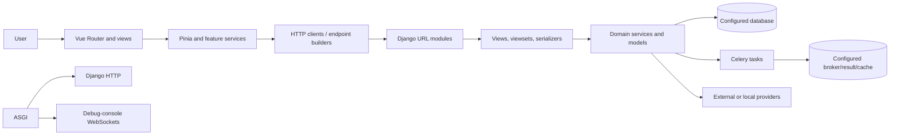

# SO_IAM_OS System Architecture

## System shape

**VERIFIED:** The source forms a browser-based Vue SPA backed by a Django project. Django mounts separate domain URL modules; the frontend organizes routes, views, services, and stores by feature. Evidence: `frontend_vue/src/main.js`, `frontend_vue/src/router/index.js`, `backend_django/backend_django/urls.py`.

**INFERRED:** This is a modular monolith rather than a set of independently deployed domain services: the Django apps are installed in one project and use the same configured database connection. Deployment topology is **UNKNOWN**.

Evidence for the flow: `frontend_vue/src/services/Shared/api.js`; `backend_django/backend_django/urls.py`; `backend_django/backend_django/asgi.py`; `backend_django/backend_django/celery.py`; `backend_django/backend_django/settings.py`. Arrows express architectural connections in code, not a verified live request trace.

## Component boundaries

| Component | Responsibility visible in source | Evidence |
|---|---|---|
| Vue application | Startup, route gating, feature views, stores, HTTP calls | `frontend_vue/src/main.js`, `frontend_vue/src/router/index.js`, `frontend_vue/src/services/` |
| Django domain apps | API routes, serializers, model persistence, domain logic | `backend_django/*/api/`, `backend_django/*/models/`, `backend_django/*/services/` |
| Async processing | Task autodiscovery and domain task functions | `backend_django/backend_django/celery.py`, `backend_django/ai/tasks/`, `backend_django/knowledge/tasks/`, `backend_django/jobs_opportunity/tasks.py`, `backend_django/automation/tasks.py`, `backend_django/tasks/tasks.py` |
| WebSocket handling | ASGI ProtocolTypeRouter directs WebSockets to debug-console routing | `backend_django/backend_django/asgi.py`, `backend_django/core/debug_console/routing.py` |
| External/local effects | Provider calls, job fetching, uploaded files, desktop automation | `backend_django/ai/providers/`, `backend_django/jobs_opportunity/tasks.py`, `backend_django/knowledge/models/knowledge_file.py`, `backend_django/automation/engine_runtime.py` |

## Cross-domain flows

**VERIFIED:** Task records may reference goal/milestone and learning objects; job skill gaps link to learning goals; learning topics link to knowledge items; projects link to goals and tasks. Evidence: `backend_django/tasks/models/task.py`, `backend_django/jobs_opportunity/models/job_skill_gap.py`, `backend_django/learning/models/learning_topic.py`, `backend_django/projects/models/project_goal.py`, `backend_django/projects/models/project_task.py`.

**PARTIAL:** These data links support integrated workflows, but static relationships do not prove a complete user-facing process or consistent transaction boundaries. Domain-specific flows are described in the [domain notes](./domains/learning-and-knowledge.md).

## Configuration boundaries

**VERIFIED:** Django settings select database, cache, Celery, Channels, media, authentication, and environment behavior. The frontend has Vite configuration and environment-based API URLs. Evidence: `backend_django/backend_django/settings.py`, `frontend_vue/vite.config.js`, `frontend_vue/src/services/Shared/api.js`.

**UNKNOWN:** Production deployment topology, runtime versions actually used, worker availability, Redis availability, and external credentials are not established by static source inspection.

See [Backend Architecture](./02-backend-architecture.md), [Frontend Architecture](./03-frontend-architecture.md), and [Security and Operations](./06-security-and-operations.md).
