# Frontend to Backend Mapping

## Evidence and status definitions

This map links frontend route/view and service source to the backend URL module that owns the matching prefix. `SOURCE-MAPPED` means the local source declarations connect the named layers; no request was executed. `REPRESENTATIVE` means the domain-level sources align but every operation, payload, permission, and response has not been traced. `CROSS-CUTTING` means the frontend area uses shared clients/routes and has no one-to-one backend app.

## Shared request path

```mermaid
flowchart LR
  Route[Vue Router: src/router/index.js] --> Page[Domain view/page]
  Page --> State[Pinia store or composable, when used]
  State --> Service[Domain service or direct request]
  Service --> Client[Shared Axios / other client]
  Client --> Endpoint[Endpoint builder or service URL]
  Endpoint --> Mount[Django project URL mount]
  Mount --> AppURL[App api/urls.py]
  AppURL --> Handler[View or ViewSet]
  Handler --> Serializer[Serializer, when used]
  Serializer --> Model[Django model/queryset]
  Model --> DB[(Configured database)]
```

Evidence anchors: `frontend_vue/src/router/index.js`; `frontend_vue/src/services/Shared/api.js`; `frontend_vue/src/services/Shared/endpoints.js`; `backend_django/backend_django/urls.py`; app `api/urls.py`, views, serializers, and `models/`. The diagram shows source-level composition only. The actual database connection, URL resolution, and HTTP result were not verified.

## Routed-domain integration index

The page names below are the primary route entries in `frontend_vue/src/router/index.js`; additional pages and component relationships are documented in the linked existing domain guides. The backend table names the matching project mount and API module. The final columns identify source anchors for one representative resource path; they do not claim every action in that domain is mapped.

| Vue domain / page | State and service source | Backend mount and URL source | Representative backend handler → serializer → model | Status |
|---|---|---|---|---|
| Accounts: `views/accounts/LoginView.vue`, `ProfileView.vue`, `AuthCallback.vue` | `stores/accounts/user.js`; `services/Accounts/usersAccounts.js`; `services/Shared/endpoints.js` (`users`) | `/api/users/`; `backend_django/users_accounts/api/urls.py` | `users_accounts_views.py` → `users_accounts_serializers.py` → `models/user.py` | REPRESENTATIVE |
| AI: `views/ai/AIChat.vue`, `AIControl.vue`, `AIOperationsView.vue`, `AgentPlanner.vue` | `services/AI/Ai.js`, `AIService.js`, `aiControl.js`, `aiPlatformService.js`, `sse.js`; AI store where imported | `/api/ai/`; `backend_django/ai/api/urls.py` | `ai/api/views/ai_views.py` → `ai/api/serializers/conversations.py` → `ai/models/conversations.py` | REPRESENTATIVE; provider/stream runtime unknown |
| Automation: `views/automation/AutomationView.vue`, `DashboardAutomationView.vue`, `ProgramList.vue`, `ProgramCreate.vue`, `ProgramEdit.vue`, `TaskCreate.vue`, `TaskEditor.vue` | `services/Automation/AutomationService.js`, `taskService.js`, `workflowService.js`, `nodeStorageService.js` | `/api/automation/`; `backend_django/automation/api/urls.py` | `api/views/` → `api/serializers/` → `models/workflow.py` / `models/task_run.py` | REPRESENTATIVE; desktop execution is a sensitive side-effect boundary |
| Challenges: `views/challenges/ChallengesView.vue` | `services/Challenges/challenges.js` | `/api/challenges/`; `backend_django/challenges/api/urls.py` | `api/views/challenges_views.py` → `api/serializers/challenges_serializers.py` → `models/challenge.py` | REPRESENTATIVE |
| Codex: `views/codex/CodexView.vue` | `services/Codex/codex.js`; Codex store where imported | `/api/codex/`; `backend_django/codex/api/urls.py` and project-level build paths in `backend_django/backend_django/urls.py` | Codex API views → serializers → `models/project_registry.py` / change and audit models | REPRESENTATIVE; file/command operations need route-level authorization review |
| Core: `views/core/DashboardView.vue`, `Settings.vue`, `MyProgress.vue` | `services/Core/dashboard.js`, `settings.js`; shared account state | `/api/core/`; `backend_django/core/api/urls.py` | `api/views/core_views.py` → `api/serializers/core_serializers.py` → core settings model where used | REPRESENTATIVE |
| Finance: `views/finance/FinanceView.vue` | `services/Finance/finance.js`; `domainEndpoints` in `services/Shared/endpoints.js` | `/api/finance/`; `backend_django/personal_finance/api/urls.py` | `api/views/` → `api/serializers/` → `models/transaction.py` and related finance models | REPRESENTATIVE; all finance operations not contract-checked |
| Goals: `views/goals/Goals.vue` | `stores/goals/goalsStore.js` → `services/Goals/goals.js` → shared Axios and `endpoints.goals` | `/api/goals/`; `backend_django/goals/api/urls.py` | `api/views/goals_views.py` → `api/serializers/goals_serializers.py` → `models/goal.py` | SOURCE-MAPPED for list/store/service/router resource chain; response/runtime not tested |
| Jobs: `views/jobs/JobsView.vue` | `services/Jobs/jobs.js` | `/api/jobs/`; `backend_django/jobs_opportunity/api/urls.py` | job API views/serializers → `models/job_opportunity.py` | REPRESENTATIVE; routed view appears to use only part of the service/API surface |
| Knowledge: `views/knowledge/knowledgeView.vue` | `stores/knowledge/` and `services/Knowledge/Knowledge.js` | `/api/knowledge/`; `backend_django/knowledge/api/urls.py` | `api/views/knowledge_item_views.py` → `api/serializers/knowledge_item_serializers.py` → `models/knowledge_item.py` | REPRESENTATIVE; file processing is asynchronous |
| Learning: `views/learning/LearningView.vue`, `LearningTopic.vue` | `services/Learning/learning.js`; domain state as imported by each view | `/api/learning/`; `backend_django/learning/api/urls.py` | learning API viewsets/serializers → `models/learning_goal.py` / `models/learning_topic.py` | REPRESENTATIVE |
| Memory: `views/memory/MemoryView.vue` | `services/Memory/memory.js` | `/api/memory/`; `backend_django/memory/api/urls.py` | `api/views/memory_views.py` → `api/serializers/memory_serializers.py` → `models/memory_item.py` | REPRESENTATIVE |
| Notifications: `views/notifications/NotificationsView.vue` | `services/Notifications/notifications.js` | `/api/notifications/`; `backend_django/notification/api/urls.py` | `api/views/notification_views.py` → `api/serializers/notification_serializers.py` → `models/notification.py` | REPRESENTATIVE |
| Projects: `views/projects/ProjectsView.vue` | `services/Projects/projects.js`; project store where imported | `/api/projects/`; `backend_django/projects/api/urls.py` | `api/views/projects_views.py` → `api/serializers/projects_serializers.py` → `models/project.py` | REPRESENTATIVE |
| Scraper: `views/scraper/ScraperView.vue` | `services/Scraper/scraperApi.js` | `/api/scraper/`; `backend_django/scraper/api/urls.py` | `api/views/scraper_views.py` → `api/serializers/scraper_serializers.py` → scraping config/job models | REPRESENTATIVE; network-source behavior is not runtime-tested |
| Social: `views/social/SocialView.vue` | `services/Social/social.js` | `/api/social/`; `backend_django/social/api/urls.py` | `api/views/social_views.py` → `api/serializers/social_serializers.py` → friendship/profile models | REPRESENTATIVE |
| Tasks: `views/tasks/TodayTasks.vue`, `TasksCalendar.vue` | `services/Tasks/tasks.js`; task store where imported | `/api/tasks/`; `backend_django/tasks/api/urls.py` | `api/views/tasks_views.py` → `api/serializers/tasks_serializers.py` → `models/task.py` | REPRESENTATIVE |
| Shared: `views/shared/HomeView.vue`, `AboutView.vue`, `Page_Not_Found.vue` and shared shell | Shared service clients, router, composables, and account store | No single backend app; shared calls use the domain mounts above | Per-operation backend handler varies | CROSS-CUTTING |

Source paths in table entries are relative to the `frontend_vue/src/` and `backend_django/` roots unless the path explicitly begins with `backend_django/`. Broad `api/views/` or `api/serializers/` entries are architectural group references; a fully exhaustive per-operation trace remains open and is not represented as complete here.

## Detailed verified trace: Goals list

1. `frontend_vue/src/router/index.js` maps `/goals` to `GoalsView`, imported from `frontend_vue/src/views/goals/Goals.vue`.
2. `Goals.vue` obtains `useGoalsStore` from `frontend_vue/src/stores/goals/goalsStore.js`.
3. `goalsStore.js` calls `goalApi.listGoalsPage` from `frontend_vue/src/services/Goals/goals.js`.
4. `goals.js` calls the shared client from `frontend_vue/src/services/Shared/api.js` with `endpoints.goals.list` from `frontend_vue/src/services/Shared/endpoints.js`.
5. `endpoints.goals.list` is `/goals/`; the configured frontend API base is sourced through the shared client. The project URL configuration mounts `goals.api.urls` under `/api/goals/` in `backend_django/backend_django/urls.py`.
6. `backend_django/goals/api/urls.py` registers the goal route to `GoalViewSet`; `backend_django/goals/api/views/goals_views.py` selects `GoalSerializer` from `backend_django/goals/api/serializers/goals_serializers.py`; the serializer's model is `Goal` from `backend_django/goals/models/goal.py`.

This proves a matching source chain. It does not prove effective Axios URL combination, a successful request, database connectivity, or response-shape compatibility at runtime.

## Unmapped and mismatch boundary

- The nine installed scaffold apps (`agents`, `ai_tools_laboratory`, `analytics`, `architecture`, `crm`, `marketing`, `revenue`, `sales`, `skills`) have no app URL module or frontend route/service identified; they are not mapped to live endpoints.
- The `shared` frontend domain has no one-to-one backend app.
- The existing API guide records a model-only `SavingPlan` without a route in `personal_finance/api/urls.py`; no frontend endpoint was verified for it.
- `frontend_vue/src/services/AI/aiPlatformService.js` marks workflow execution unsupported even though related backend workflow routes exist; the two are not a verified completed flow.
- Existing mapping notes identify partial Jobs and Automation surfaces. An API operation without a known consumer is not labeled unused because indirect and dynamic consumers were not exhaustively resolved.
- Full method, request/response schema, permission, and frontend/backend compatibility checks are not complete. See `API_INTEGRATION_CATALOGUE.md` and `INTEGRATION_GAPS.md`.
