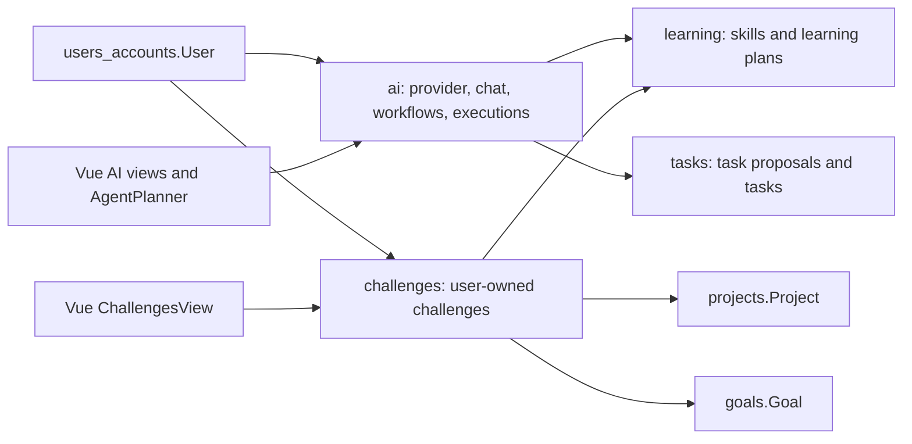

# Priority application responsibility and integration map

Updated: 2026-11-22. This describes the checked-out code, not the target tree in
`Build/No/Project_structure.md`.

## Summary

| Application | Current ownership | Models/services/serializers/views/routes | Permissions and tests | Frontend / integration state |
|---|---|---|---|---|
| `agents` | No implemented domain ownership yet. Operational agent planning currently lives in `ai`. | `models.py`, `views.py`, `tests.py`, and `admin.py` are Django scaffold files. No services, serializers, API views, or `api/urls.py`; no migrations beyond `__init__.py`. | No app-specific permissions or meaningful tests. | No Agents page, store, or agent service. `views/ai/AgentPlanner.vue` consumes `/api/ai/` through `services/AI/aiControl.js`. Avoid duplicating the AI workflow and selection implementations. |
| `ai` | Provider configuration, conversation/chat, prompt profiles, workflows, budgets, feedback, audit and execution/usage observability. | Implemented models under `models/`, provider adapters under `providers/`, business logic under `services/`, serializers and API views under `api/`. `ai.api.urls` is mounted at `/api/ai/`. | Authenticated API permissions; ownership is generally enforced in view querysets/services. Has provider, security, regression, architecture and API tests. | `views/ai/*`, `stores/ai/useAIStore.js`, `services/AI/*`; `AgentPlanner.vue` uses existing plan/select/proposal endpoints. Depends on the custom user, learning, task and conversation/model domains. |
| `ai_tools_laboratory` | No implemented tool catalog or execution ownership. | `models.py`, `views.py`, `tests.py`, `admin.py` are scaffold files. No model definitions, services, serializers, API views/URLs, or migrations. | No app-specific permissions or meaningful tests. | No laboratory page, service, or store found. Tool execution should reuse AI/provider controls and explicit permission policy once a real tool contract exists. |
| `analytics` | No implemented analytics domain. | Scaffold files only; no models, services, serializers, API views/URLs, or migrations. | No app-specific permissions or meaningful tests. | No Analytics-specific frontend consumer found. Existing dashboard consumers use `core`; do not duplicate dashboard aggregation here until ownership is defined. |
| `architecture` | No implemented architecture registry or drift-report domain. | Scaffold files only; no models, services, serializers, API views/URLs, or migrations. | No app-specific permissions or meaningful tests. | No Architecture UI/API consumer found. Architecture documentation exists under `Build/source_architecture`; it is not backed by a runtime API. |
| `challenges` | User-owned challenges, ordered steps, attempts, and per-user progress. | Four models, serializers, authenticated `ModelViewSet`s, and a `DefaultRouter` under `api/`; `/api/challenges/` is mounted in project URLs. No separate services. | Querysets are user-scoped; create/update now also validate that referenced challenges belong to the requester. Three API ownership regression tests added. | `views/challenges/ChallengesView.vue` calls `services/Challenges/challenges.js`; list/create/update/delete challenge operations exist. The view currently lacks explicit error and empty states. Depends on `users_accounts`, `learning.Skill`, `projects.Project`, and `goals.Goal`. |
| `crm` | No implemented CRM domain. | Scaffold files only; no models, services, serializers, API views/URLs, or migrations. | No app-specific permissions or meaningful tests. | No CRM frontend consumer found. `sales` and marketing have no existing CRM contract to integrate against. |
| `marketing` | No implemented marketing domain. | Scaffold files only; no models, services, serializers, API views/URLs, or migrations. | No app-specific permissions or meaningful tests. | No Marketing frontend consumer found. No campaign or attribution API exists. |
| `revenue` | No implemented revenue domain. | Scaffold files only; no models, services, serializers, API views/URLs, or migrations. | No app-specific permissions or meaningful tests. | No Revenue frontend consumer found. No subscription, invoice, or revenue API exists. |
| `sales` | No implemented sales domain. | Scaffold files only; no models, services, serializers, API views/URLs, or migrations. | No app-specific permissions or meaningful tests. | No Sales frontend consumer found. No pipeline or CRM contract exists. |

## Existing dependency and ownership flow

## Route audit

`backend_django/backend_django/urls.py` mounts `ai`, `challenges`, and the
existing core domains. It has no route include for `agents`,
`ai_tools_laboratory`, `analytics`, `architecture`, `crm`, `marketing`, `revenue`,
or `sales`. Those eight apps currently lack concrete models and API contracts,
so no placeholder endpoint was added. `AgentPlanner` already calls the existing
AI API; adding a parallel agent planner endpoint would duplicate ownership.

## Test-suite stall investigation

- Django's test runner reports its SQLite test database as
  `file:memorydb_default?mode=memory&cache=shared`; targeted API test runs apply
  migrations to that in-memory database, not the tracked `db.sqlite3`.
- The previous full run emitted progress from AI provider/API tests, then stopped
  producing output for several minutes. It was interrupted, so the suite result
  is unknown.
- Source inspection found a local threaded HTTP server in
  `ai/tests/test_provider_switching_e2e.py`; it is started as a daemon and closed
  in `tearDownClass`. The tests do not call real cloud providers. Their HTTP
  requests use local loopback endpoints. This is a candidate for focused timing,
  but the current evidence does not establish it as the stalled test.
- Run modules with `--verbosity 2` to expose the last active test before retrying
  the full suite. Do not claim the full suite passed until the command exits 0.

## Next integration slices

1. Add a documented, executable AI provider switching test timing run and isolate
   any hang by module.
2. Define actual domain and ownership contracts for the eight scaffold apps
   before creating their models or APIs.
3. Implement the first approved domain end-to-end, including service, API,
   permissions, frontend consumer, and persistence tests.
4. Keep the `agents` app as the owner of reusable agent definitions only if that
   can reference the existing AI provider router and execution records without
   duplicating them.
